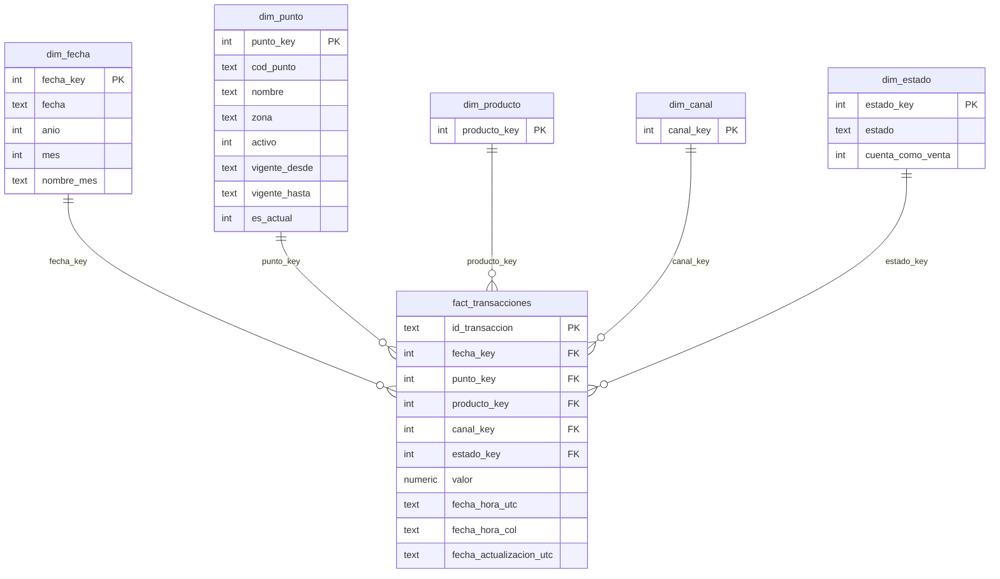

# Sección 3. Pipeline (B2)

## 3.1 Reglas de limpieza y por qué

Los archivos llegaron con problemas que el diccionario de datos no menciona. Cada fila se descarta por el
primer motivo que le aplique, así lo leído siempre cuadra con lo cargado más lo descartado
(el código lo verifica y falla si no cuadra).

| Regla | Justificación | Filas en `transacciones.csv` |
|---|---|---|
| Leer todo como texto; el maestro en Windows-1252 y las transacciones en UTF-8 con BOM | El maestro trae tildes en otra codificación. Leer números directamente borra los ceros de `00101`. | todas |
| `estado`: quitar espacios y pasar a mayúsculas | Llegan `" aprobada "` y `Aprobada`. Sin esto no se reconocen como ventas. | 349 corregidas |
| `cod_punto`: completar a 5 dígitos | Llegan `101` en vez de `00101`. Sin esto no cruzan con el maestro. | 846 corregidas |
| `valor`: `1.299.000` y `522.500` se leen como miles; `10000.00` como decimal | Hay tres formatos. Es un supuesto: un punto seguido de exactamente tres dígitos es separador de miles, porque en pesos no hay milésimas. | 429 corregidas |
| `fecha_*`: aceptar ISO, `dd/mm/aaaa hh:mm` e ISO con `T` y `Z` | Hay tres formatos. El de `dd/mm/aaaa` no trae segundos. | 835 corregidas |
| Día de negocio = fecha en hora Colombia (UTC-5) | El core opera en UTC. Una venta de las 8 p. m. del 27/10 llega fechada 28/10 01:00. Con UTC, todo lo vendido entre las 7 p. m. y la medianoche caería en el día siguiente. | todas |
| Misma transacción repetida: quedarse con la de mayor `fecha_actualizacion` | El core manda el historial de cambios de estado. | 143 versiones anteriores y 138 duplicados exactos |
| Descartar el punto de pruebas (90001) | Lo pidió Laura. | 24 |
| Descartar `cod_punto` que no existe en el maestro (00199) | Sin punto no hay zona, y no se debe inventar. | 12 |
| Descartar `cod_punto` vacío | Igual que el anterior. | 4 |
| Descartar `valor` vacío | Son ventas aprobadas sin monto; no se inventa. Quedan en la hoja Calidad para pedírselas al proveedor. | 5 |

Maestro de puntos (42 filas leídas, 40 válidas):

* El código `00117` aparece dos veces, una con Rionegro Llanogrande (Oriente, inactivo) y otra con Envigado
  La Magnolia (Valle de Aburrá, activo). Se conserva el activo, porque el punto tiene transacciones recientes.
* Dos zonas venían con mayúsculas o espacios distintos (`VALLE DE ABURRA`, `oriente `) y se normalizaron.
* El `00133` no tiene zona. Se deja como «Sin zona» en vez de asignarle una al azar.
* El `90001` (pruebas) se excluye.

## 3.2 Modelo de datos

Decisiones:

* La tabla de hechos guarda todos los estados, no solo las ventas. Si solo se cargara lo aprobado, una
  anulación posterior nunca podría reflejarse. La regla «venta = APROBADA o REVERSADA» vive en
  `dim_estado.cuenta_como_venta` y en la vista `vw_ventas`.
* La llave es `id_transaccion`. Repetir la carga no duplica, y una fila solo se reemplaza si llega con una
  `fecha_actualizacion` más reciente. Por eso da lo mismo cargar el principal antes o después del delta.
* `dim_punto` guarda la historia de la zona. Si un punto cambia de zona se cierra su versión y se abre otra, y los
  hechos ya cargados conservan la zona de su época. Es la respuesta al caso A9: el pasado no se mueve.
* Todo el cargue (maestro, hechos y calidad) corre en una sola transacción. Si algo falla, no queda nada a medias.
* Las tablas `dq_resumen`, `dq_descartados` y `etl_cargas` guardan la calidad y la bitácora de cada carga.

## 3.3 Resultados del 27/10/2026

Ventas por zona (APROBADA + REVERSADA, hora Colombia), antes y después de aplicar el delta:

| Zona | Ventas antes | Trx antes | Ventas después | Trx después | Diferencia |
|---|---:|---:|---:|---:|---:|
| Valle de Aburrá | $448.811.200 | 1.097 | $414.550.400 | 1.090 | −$34.260.800 |
| Oriente | $176.206.300 | 426 | $170.766.700 | 429 | −$5.439.600 |
| Suroeste | $88.668.300 | 245 | $91.302.300 | 249 | +$2.634.000 |
| Norte | $116.353.000 | 300 | $110.938.100 | 301 | −$5.414.900 |
| Urabá | $93.390.200 | 271 | $96.810.800 | 278 | +$3.420.600 |
| Sin zona | $31.003.200 | 93 | $31.837.400 | 97 | +$834.200 |
| **Total** | **$954.432.200** | **2.432** | **$916.205.700** | **2.444** | **−$38.226.500** |

Registros descartados con fecha del 27/10, por motivo:

| Motivo | Antes (principal) | Después (principal + delta) |
|---|---:|---:|
| Versión anterior de la misma transacción | 59 | 60 |
| Punto de pruebas | 12 | 12 |
| `cod_punto` inexistente (00199) | 8 | 8 |
| Duplicado exacto | 7 | 7 |
| `cod_punto` vacío | 4 | 4 |
| `valor` vacío | 3 | 3 |
| **Total** | **93** | **94** |

Carga del delta (2.111 filas leídas, 2.110 válidas): 2.005 insertadas, 52 actualizadas y 53 ignoradas. Las 53
ignoradas traían una `fecha_actualizacion` igual o anterior a la que ya estaba cargada.

Por qué cambia el 27/10 (la diferencia sale de dos efectos que se pueden contar):

* Suma 50 ventas nuevas del 27/10 que el delta trae por primera vez: +$31.236.500.
* Hay 52 transacciones del 27/10 con cambio de estado. 38 pasaron de APROBADA a ANULADA y dejan de contar:
  −$69.463.000. Las otras 14 pasaron de APROBADA a REVERSADA y siguen contando, porque se cobró la comisión.

Neto: +$31.236.500 − $69.463.000 = −$38.226.500, y +50 − 38 = +12 transacciones. Coincide con la tabla.

Verificación: estos totales se reconstruyeron con un script aparte, que no usa el código del pipeline, desde los
CSV crudos y coinciden hasta el último peso. La carga también se repitió tres veces (principal, delta y principal
otra vez) sin cambiar un solo dato.

## 3.4 Preguntas abiertas para Laura (afectan estos números)

1. ¿A qué zona pertenece el punto `00133`? Hoy suma $31.837.400 como «Sin zona».
2. ¿El `00117` es La Magnolia (Valle de Aburrá)? Se asumió que sí. Cambiarlo mueve ventas entre Valle y Oriente.
3. ¿Qué hacemos con las 5 ventas aprobadas sin valor? Hoy quedan fuera y listadas en Calidad.
4. ¿Las RECHAZADAS nunca cuentan? Se asumió que no.
5. ¿El punto 00199 existe? Tiene 12 transacciones y no está en el maestro.
