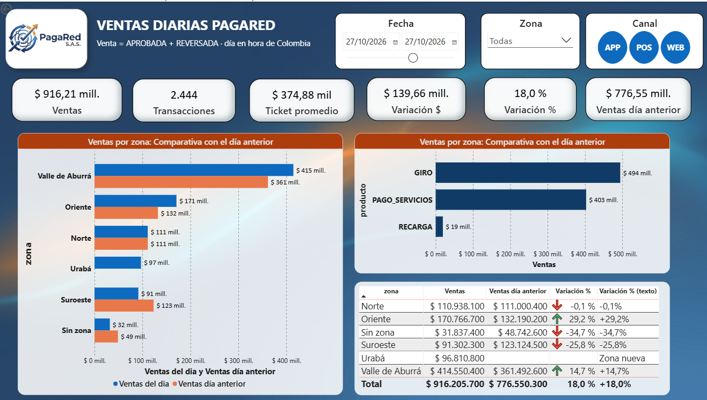
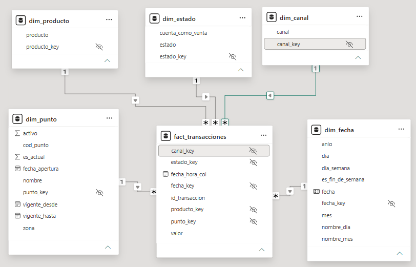

# Sección 7. Tablero en Power BI (B6)

El tablero es de una página y está conectado a las tablas del modelo exportadas a CSV (`powerbi/datos_modelo/`),
generadas con `python -m etl.pipeline --exportar-csv powerbi/datos_modelo` después de aplicar el delta. Usé CSV y
no SQLite porque Power BI no trae el controlador ODBC de SQLite, y la prueba permite esa salida.

## 7.1 Modelo y relaciones

Esquema en estrella. Todas las relaciones son de muchos a uno, con filtro de la dimensión hacia el hecho (dirección única).

| Hecho | Dimensión | Columna |
|---|---|---|
| fact_transacciones | dim_fecha | fecha_key |
| fact_transacciones | dim_punto | punto_key |
| fact_transacciones | dim_producto | producto_key |
| fact_transacciones | dim_canal | canal_key |
| fact_transacciones | dim_estado | estado_key |

Ajustes en Power Query, cada uno por una razón concreta: `cod_punto` como texto, porque como número «00101» pierde los
ceros; `valor` como decimal fijo y no como decimal, para no arrastrar el problema de redondeo del float (A3);
`dim_fecha[fecha]` como fecha, marcada como tabla de fechas; la columna `valor` en «No resumir», para que nadie
arme un visual con una suma implícita sin la regla de negocio. Se quitan las columnas técnicas (`archivo_origen`,
`cargado_en`, las fechas UTC) y se ocultan las llaves (`*_key`) en la vista de informe.

## 7.2 Medidas DAX

La regla de negocio (venta = APROBADA o REVERSADA) vive en una sola medida, `Ventas`, y las demás parten de ella.

```dax
Ventas =
CALCULATE (
    SUM ( fact_transacciones[valor] ),
    dim_estado[cuenta_como_venta] = 1
)

Transacciones =
CALCULATE (
    COUNTROWS ( fact_transacciones ),
    dim_estado[cuenta_como_venta] = 1
)

Ticket promedio =
DIVIDE ( [Ventas], [Transacciones] )

Ventas día anterior =
CALCULATE ( [Ventas], DATEADD ( dim_fecha[fecha], -1, DAY ) )

Variación $ =
[Ventas] - [Ventas día anterior]

Variación % =
DIVIDE ( [Variación $], [Ventas día anterior] )
```

Para las tarjetas y la tabla:

```dax
Variación % (texto) =
VAR Previo = [Ventas día anterior]
RETURN
    IF (
        ISBLANK ( [Ventas] ) && ISBLANK ( Previo ),
        BLANK (),
        IF (
            ISBLANK ( Previo ) || Previo = 0,
            "Zona nueva",
            FORMAT ( [Variación %], "+0.0%;-0.0%" )
        )
    )

Transacciones día anterior =
CALCULATE ( [Transacciones], DATEADD ( dim_fecha[fecha], -1, DAY ) )

Variación transacciones % =
DIVIDE ( [Transacciones] - [Transacciones día anterior], [Transacciones día anterior] )

Ticket día anterior =
CALCULATE ( [Ticket promedio], DATEADD ( dim_fecha[fecha], -1, DAY ) )

Variación ticket % =
DIVIDE ( [Ticket promedio] - [Ticket día anterior], [Ticket día anterior] )
```

`DIVIDE` devuelve vacío cuando el divisor es cero o vacío, así que una zona sin ventas el día anterior no produce error
ni infinito. En la tabla, la medida de texto muestra «Zona nueva» en ese caso. Con el 27/10 seleccionado es Urabá:
vendió $96.810.800 y el 26/10 no tuvo ventas.

## 7.3 Visuales

| Visual | Campos | Requisito |
|---|---|---|
| 6 tarjetas | Ventas, Transacciones, Ticket promedio, Variación $, Variación % y Ventas día anterior | 1 y 3 |
| Barras agrupadas por zona | Eje: `dim_punto[zona]`; valores: Ventas y Ventas día anterior | 2 y 3 |
| Barras por producto | Eje: `dim_producto[producto]`; valor: Ventas | 2 |
| Tabla de variación por zona | Zona, Ventas, Ventas día anterior, Variación % (con flecha) y Variación % (texto) | 3 |
| Segmentadores | Fecha (rango, con el 27/10 seleccionado), zona (desplegable) y canal (botones) | 4 |

## 7.4 Qué decisión le ayuda a tomar a Laura

Con el 27/10 Laura decide a qué zona llamar primero: las ventas subieron 18,0 %, pero Suroeste cayó 25,8 % y «Sin zona» 34,7 %. Las tarjetas dan el pulso del día, las barras comparan cada zona con la víspera y la tabla da la cifra exacta, con Urabá como «Zona nueva» y no como error. Giro aporta el 54 % de las ventas con el 14 % de las transacciones.

## 7.5 Cifras de control (27/10, con el delta aplicado)

Estas son las cifras que el tablero debe mostrar, calculadas por aparte en pandas desde los mismos CSV.
Ventas **$916.205.700**, transacciones **2.444**, ticket promedio **$374.879,58** (26/10: $776.550.300 y 2.143).

| Zona | Ventas 27/10 | Transacciones | Ventas 26/10 | Variación % |
|---|---|---|---|---|
| Valle de Aburrá | $414.550.400 | 1.090 | $361.492.600 | +14,7 % |
| Oriente | $170.766.700 | 429 | $132.190.200 | +29,2 % |
| Norte | $110.938.100 | 301 | $111.000.400 | −0,1 % |
| Urabá | $96.810.800 | 278 | $0 | vacío (zona nueva) |
| Suroeste | $91.302.300 | 249 | $123.124.500 | −25,8 % |
| Sin zona | $31.837.400 | 97 | $48.742.600 | −34,7 % |

## 7.6 Pantallazos





## 7.7 Limitaciones

* Solo el 26 y el 27/10 son días completos. El 25/10 empieza a las 8 p. m. (el archivo arranca el 26/10 a la 1:00 a. m. UTC) y el 28/10 llega hasta las 6 p. m. por el corte del incremental. Un día seleccionado junto a uno incompleto mostraría una variación engañosa.
* «Sin zona» corresponde al punto 00133, que el maestro no trae con zona. Se deja visible a propósito.
* Seguridad por filas (opcional): un rol por zona, con el filtro `[zona] = "Oriente"` sobre `dim_punto`, que se prueba con «Ver como».
